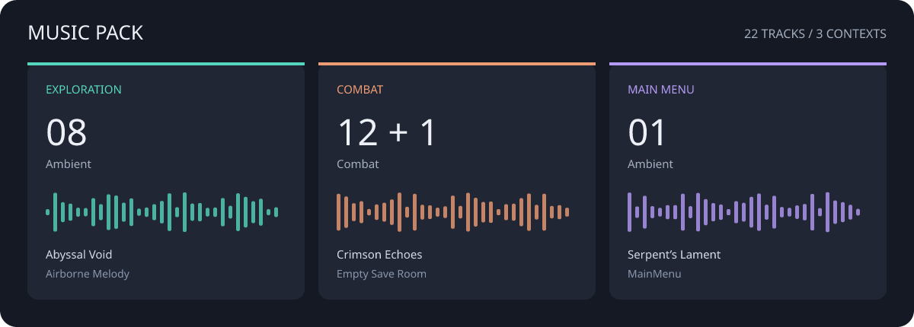

# Music Pack — あなたのゲームのためのサウンドトラック

探索・戦闘・メインメニューのための**22曲**。音声を物語 MOD ごとにコピーせずに、cthangover の複数のゲームでサウンドトラックを共用できます。



## プレイヤーに聞こえるもの

- **探索：** 専用プレイリストを持たないシーン（RPG マップを含む）のための8曲。
- **戦闘：** プレイリスト `Battle` の12曲。予備の戦闘プレイリスト `default` には `Empty Save Room` も含まれ、計13曲になります。
- **メインメニュー：** `Serpent's Lament`。

> Music Pack が提供するのは音声とプレイリストです。ロケーション・クエスト・ゲームプレイの仕組みは追加しません。

## 何か設定は必要か

ゲームがすでに Music Pack を使っていれば、曲を個別にインストールしたり選んだりする必要はありません。再生は `audio_base` システムが担います。

このパックは、メインメニュー、Cthangover、ノベルテンプレート、プロジェクトの RPG ゲームが使っています。メインゲームの物語コンテンツを必要としません。

## 自分のゲームで使う

1. `music_pack` とその依存関係 `audio_base` をインストールします。
2. 自分のコンテンツ MOD の `manifest.json` にある既存の `depends` リストに `music_pack>=1` を追加します。
3. 付属のプレイリストを使うか、独自の選曲なら自分の MOD の `music/playlists/` ディレクトリに JSON ファイルを追加します。

依存関係の例：

```jsonc
// 既存のリストに依存関係を追加します：
"depends": ["music_pack>=1"]
```

独自プレイリストの置き場所の例：

```filestree
my_game/
├── manifest.json
└── music/
    └── playlists/
        └── my_scene.json  # あなたのシーンの音楽
```

シーン `my_scene` 用のプレイリストの例：

```json
{
  "Scene": "my_scene",
  "Musics": [
    {
      "MusicType": "Ambient",
      "MusicNames": ["Airborne Melody", "Twilight Interlude"]
    }
  ]
}
```

曲名は **`.ogg` 拡張子を付けず**、大文字小文字とスペースをそのままに書きます。`my_scene` は自分のシーン名に置き換えてください。

## 収録プレイリスト

- `default` — 探索音楽（`Ambient`）と予備の戦闘音楽（`Combat`）。
- `Battle` — 両方のバトルシステム向けの戦闘音楽。
- `MainMenu` — メインメニューのテーマ。

プレイリスト `town_entry` は物語 MOD `cthangover_game` の側にあり、このパックには含まれません。

## 全22曲

### 探索

Abyssal Void · Airborne Melody · Binary Prelude · Cinders of Dawn · Melancholic Journey · Nebula Pulse Echoes · Quantum Archive · Twilight Interlude.

### 戦闘と予備の戦闘リスト

Aura of Decay · Circuit Dreams II · Crimson Echoes · Crimson Horizon · Empty Save Room · Glass Symphony · Hex Doom Cart · Iron Resonance · Iron Resonance II · Luminous Twilight · Rusty Frequencies · Skull Resonance · Venom's Embrace.

### メインメニュー

Serpent's Lament.

## 音が鳴らないとき

- `music_pack` と `audio_base` がインストールされ、有効になっているか確認してください。
- ゲーム設定の音楽音量を確認してください。
- 特定のシーンだけの問題なら、そのシーン専用のプレイリストと曲名の正確なつづりを確認してください。
- 後から読み込まれた依存 MOD は、同じシーンと同じ音楽の種類について選曲を差し替えられます。
